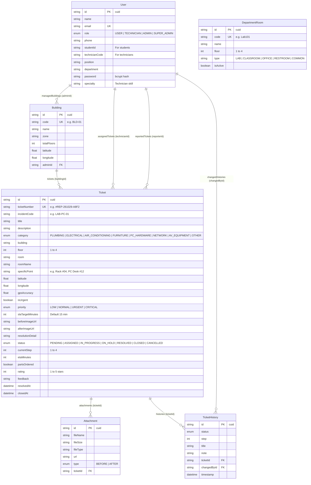
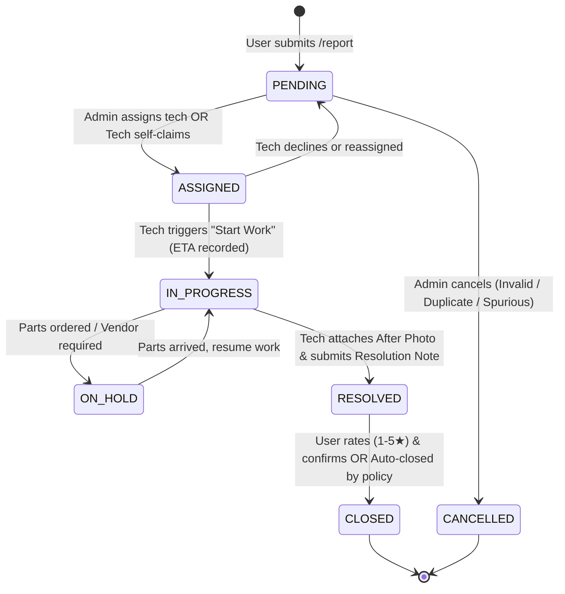

# 📋 Campus Facility Maintenance & Issue Tracking System (CampusOps)
## Complete Technical Architecture, System Workflows & AI Analysis Specification

> **Target Audience / Purpose:** This document provides an exhaustive, structured technical specification and architectural overview of the **CampusOps** project. It is specifically designed for AI agents, technical reviewers, and senior developers to rapidly analyze, evaluate, audit, or extend the system codebase.

---

## 1. Executive Summary & Domain Scope

| Metric / Dimension | Specification Details |
| :--- | :--- |
| **System Name** | Campus Facility Maintenance & Issue Tracking System (**CampusOps**) |
| **Application Domain** | Higher Education Facility Management, Computer Lab & IT Equipment Repair Ops |
| **Scope of Deployment** | Institutional Campus Portal with primary focus on the **Department of Computer Engineering / Computer Technical Building (4 Floors)** |
| **Key Objectives** | 1. Reduce incident reporting barrier for students & faculty (mobile-first, GPS auto-lock, proof photo)<br>2. Eliminate duplicate maintenance tickets in shared labs<br>3. Provide dispatchers and administrators with an interactive 2.5D building floor map<br>4. Enforce SLA-driven response (15-30 mins) with technician accountability (Proof-of-Work: Before/After Photos) |
| **Architecture Pattern** | Modular Next.js 14 App Router, Server Actions, Layered Architecture, Strict Zod Validation, Relay/Prisma ORM |

---

## 2. Technical Stack & Implementation Architecture

### 2.1 Core Technologies
```
[Frontend Client] Next.js 14 (App Router) + React 18 + Tailwind CSS + Lucide Icons + react-zoom-pan-pinch
        │
        ▼ (Type-safe Server Actions + Zod Validation)
[Backend Services] Next.js Server Actions (`actions/*.ts`) + Node.js Runtime
        │
        ├── Session / Auth: Custom JWT (`jose`) + HTTP-only Secure Cookies + `bcryptjs`
        └── Business Logic: Collision-proof Ticket Generator, Duplicate Detection, SLA Monitor
        │
        ▼ (Prisma Client ORM)
[Database Layer] PostgreSQL 17 (Prisma Relational Models, Indexes, Enums)
```

### 2.2 Directory Structure
```
c:\Campus Facility Maintenance and Issue Tracking System\
├── actions/                   # Server Actions (Type-safe Backend Mutations)
│   ├── auth.ts                # Session creation, login, register, logout
│   ├── building.ts            # Campus building master data CRUD
│   ├── room.ts                # Department lab/room master data CRUD
│   ├── ticket.ts              # Ticket lifecycle, triage, claim, resolve, rating
│   └── user.ts                # User management & RBAC elevation
├── app/                       # Next.js 14 App Router
│   ├── (public)/              # Portal (`/`), Login (`/login`), Register (`/register`)
│   ├── report/                # Student/Reporter Mobile-first submission form
│   ├── tracking/[id]/         # Real-time multi-step ticket status tracker
│   ├── student/dashboard/     # Personal student incident dashboard
│   ├── technician/            # Field technician operations
│   │   ├── dashboard/         # Daily queue, urgent notices, response analytics
│   │   ├── kanban/            # Live task board (Drag & drop)
│   │   ├── active-task/[id]/  # Work-in-progress execution & resolution screen
│   │   └── history/           # Closed jobs archive with Before/After inspection
│   ├── admin/                 # Facility management operations
│   │   ├── dashboard/         # Operational metrics & SLA health
│   │   ├── floor-plan/        # Interactive 2.5D Building Floor Map
│   │   ├── triage/            # Incoming ticket dispatch & duplicate detection
│   │   ├── tickets/           # Master query archive & filters
│   │   ├── reports/           # Departmental SLA & technician performance
│   │   └── kanban/            # Central facility Kanban
│   └── super-admin/           # Enterprise governance
│       ├── dashboard/         # System overview & security health
│       ├── users/             # Comprehensive RBAC management table
│       ├── settings/          # Master data (Buildings, Rooms, SLA targets)
│       └── audit/             # System audit & compliance trail
├── components/                # Modular React UI components
│   ├── admin/                 # Modals, Triage tables, Heatmaps, Filters
│   ├── building/              # 2.5D Isometric Floor Plan & Room Detail Drawers
│   ├── kanban/                # Drag-and-drop ticket columns & task cards
│   ├── navigation/            # Role-aware Navbars, Sidebars & Mobile Dock
│   ├── report/                # Camera capture, GPS locator, Room selector
│   ├── technician/            # Active job timer, Proof-of-work camera, Notes
│   └── tracking/              # 4-Step stepper, Technician contact card, Rating
├── lib/                       # Core utilities & constants
│   ├── auth.ts                # JWT cookie verification & password hashing
│   ├── prisma.ts              # Prisma singleton instance
│   ├── validations/           # Zod schemas (ticket, user, auth)
│   └── constants/             # Floor plans, room definitions, campus coordinates
├── prisma/
│   ├── schema.prisma          # PostgreSQL schema definition
│   └── seed.ts                # Comprehensive mock data conforming to Figma specs
└── middleware.ts              # Edge Route Protection & RBAC redirection
```

---

## 3. Database Schema & Data Models

### 3.1 Entity-Relationship (ER) Diagram



### 3.2 Enums Definition

| Enum Name | Values |
| :--- | :--- |
| **`Role`** | `USER`, `TECHNICIAN`, `ADMIN`, `SUPER_ADMIN` |
| **`TicketStatus`** | `PENDING`, `ASSIGNED`, `IN_PROGRESS`, `ON_HOLD`, `RESOLVED`, `CLOSED`, `CANCELLED` |
| **`Priority`** | `LOW`, `NORMAL`, `URGENT`, `CRITICAL` |
| **`Category`** | `PLUMBING`, `ELECTRICAL`, `AIR_CONDITIONING`, `FURNITURE`, `PC_HARDWARE`, `NETWORK`, `AV_EQUIPMENT`, `IT_EQUIPMENT`, `OTHER` |
| **`AttachmentType`** | `BEFORE`, `AFTER` |

---

## 4. Role-Based Access Control (RBAC) Specification

| Route Pattern | `USER` (Student/Staff) | `TECHNICIAN` (Field Tech) | `ADMIN` (Building Ops) | `SUPER_ADMIN` (System IT) |
| :--- | :---: | :---: | :---: | :---: |
| `/` (Portal & Quick Search) | ✅ Read | ✅ Read | ✅ Read | ✅ Read |
| `/report` (Create Ticket) | ✅ Full | ✅ Full | ✅ Full | ✅ Full |
| `/tracking/[id]` (Status & Rating) | ✅ Full | ✅ Read/Update | ✅ Full | ✅ Full |
| `/student/dashboard` | ✅ Own Tickets | ❌ | ❌ | ✅ All |
| `/technician/*` (Kanban, Active, History) | ❌ | ✅ Assigned Jobs | ✅ Read Only | ✅ Full |
| `/admin/dashboard` & `/admin/triage` | ❌ | ❌ | ✅ Full | ✅ Full |
| `/admin/floor-plan` (2.5D Map) | ❌ | ✅ Read | ✅ Full | ✅ Full |
| `/admin/reports` & `/admin/tickets` | ❌ | ❌ | ✅ Full | ✅ Full |
| `/super-admin/*` (Users, RBAC, Settings, Audit) | ❌ | ❌ | ❌ | ✅ Full |

---

## 5. End-to-End System Workflows & State Machine

### 5.1 Ticket Lifecycle State Machine



### 5.2 Step-by-Step Functional Workflows

#### A. Reporter / Student Journey
1. **Discovery & Quick Check:** Access `/` or `/report`.
2. **Input Formulation:**
   - Selects issue category (e.g. `PC_HARDWARE`, `AIR_CONDITIONING`, `NETWORK`).
   - Mobile camera triggers proof photo (saved as `BEFORE` attachment).
   - GPS Auto-Lock captures `latitude`, `longitude`, `gpsAccuracy`.
   - Selects floor (1-4) and room (e.g. `Lab 101 - Hardware Maintenance Lab`).
   - Flags urgency switch (escalates priority to `CRITICAL` + SLA 15 min).
3. **Submission:** Calls `createTicketAction` -> Guaranteed unique ticket number generated (`#REP-YYMMDD-XXXX`).
4. **Live Tracking:** Redirects to `/tracking/[ticketNumber]`.
   - Real-time 4-step stepper (Received -> Assigned -> In Progress -> Resolved).
   - Real-time technician profile card (Name, Technician ID, Avatar, Direct Call button).
   - Star rating (1-5★) and comment submission upon resolution.

#### B. Building Operations / Admin Journey
1. **Triage Queue (`/admin/triage`):**
   - Evaluates incoming `PENDING` tickets.
   - **Duplicate Detection:** Automatic banner highlights existing unresolved tickets in the same room/sub-location within a 24-hour window.
   - Dispatches ticket to on-duty technician based on specialty and current active workload.
2. **Interactive 2.5D Floor Plan (`/admin/floor-plan`):**
   - Visual inspection of the 4-floor Computer Technical building.
   - Rooms rendered with live issue badges (Red = Critical, Amber = In Progress, Green = Clear).
   - Click room/sub-pin to open `RoomDetailDrawer` with instant triage actions.
3. **Governance & Analytics (`/admin/reports`):**
   - Monitors SLA compliance percentages, mean time to resolve (MTTR), and recurring hardware failures by lab.

#### C. Technician Field Operations Journey
1. **Task Intake:**
   - Visits `/technician/dashboard` or `/technician/kanban`.
   - Views assigned jobs or claims unassigned tickets directly from the queue.
2. **Field Execution (`/technician/active-task/[id]`):**
   - Reviews incident coordinates, room number, and user's `BEFORE` image.
   - Clicks "Start Work" -> sets ticket to `IN_PROGRESS`, calculates travel ETA.
   - If missing components, toggles "Order Parts" -> status changes to `ON_HOLD`.
3. **Completion & Proof of Work:**
   - Captures and uploads `AFTER` photograph showing restored functionality.
   - Writes technical root cause and resolution details.
   - Clicks "Complete Job" -> transitions to `RESOLVED`, logs timestamp, triggers user review prompt.
4. **Work Archive (`/technician/history`):**
   - Side-by-side Before/After photo comparison viewer.
   - Review scores and feedback inspection.

---

## 6. Highlight Modules & Architectural Innovations

### 6.1 Interactive 2.5D Building Floor Map (`BuildingFloorMap.tsx`)
- **Technology:** `react-zoom-pan-pinch` with customized SVG/HTML isometric layers.
- **Data Model:** `BUILDING_FLOORS_PLAN` supporting 4 distinct floors with pre-calibrated room coordinates, sub-pins (PC units, server racks, electrical panels, AC units).
- **Interactive Capabilities:**
  - Dynamic Floor Switcher (Floor 1 to Floor 4).
  - Smooth Pan & Zoom with zoom boundaries, centering, and reset controls.
  - Live Ticket Heatmap: Computes ticket density per room and dynamically styles SVG polygons (gradient alerts).
  - Sub-Pin Micro-Location: Directly highlights specific problem spots (e.g. *Server Rack #04* or *Computer Desk #12*).
  - Direct Action Drawer: Enables immediate technician assignment without leaving the spatial view.

### 6.2 Collision-Proof Ticket Generator (`generateUniqueTicketNumber`)
```typescript
// Algorithm: Collision Defense Loop with Entropy Suffix
// Format: #REP-YYMMDD-XXXX (e.g. #REP-261029-A8F2)
// Checks both '#...' and non-'#' variants against PostgreSQL index with up to 5 retries.
```

### 6.3 Smart Duplicate Detection Engine (`checkDuplicateTicketsAction`)
- When creating or reviewing a ticket, queries active tickets (`PENDING`, `ASSIGNED`, `IN_PROGRESS`) sharing:
  - Exact `building` and `floor`
  - Matching `room` or `roomName`
  - Same `category` or overlapping `specificPoint`
- Returns candidate list to prevent technician swarm or redundant parts requisition.

---

## 7. Server Actions API Reference (`actions/`)

| Action Name | Source File | Required Role | Inputs | Key Operations / Outputs |
| :--- | :--- | :---: | :--- | :--- |
| `createTicketAction` | `ticket.ts` | Any | `CreateTicketInput` (Zod) | Generates unique ID, writes `BEFORE` attachments, logs history, revalidates paths. |
| `getTicketByIdOrNumberAction` | `ticket.ts` | Any | `idOrNumber: string` | Fetches ticket with reporter, technician, attachments, and historical audit trail. |
| `getKanbanTicketsAction` | `ticket.ts` | Authenticated | `filters?: { building?, floor?, isUrgent? }` | Returns partitioned columns: `PENDING`, `IN_PROGRESS`, `RESOLVED`. |
| `assignTechnicianAction` | `ticket.ts` | Admin / Super | `{ ticketId, technicianId, note? }` | Links technician, sets `ASSIGNED`, creates audit log entry. |
| `claimTicketAction` | `ticket.ts` | Technician | `ticketId: string` | Self-assigns ticket to session technician. |
| `startWorkAction` | `ticket.ts` | Technician | `{ ticketId, etaMinutes? }` | Transitions to `IN_PROGRESS`, updates ETA and step counter. |
| `putTicketOnHoldAction` | `ticket.ts` | Technician | `{ ticketId, reason, partsOrdered }` | Transitions to `ON_HOLD`, updates supply flag. |
| `resolveTicketAction` | `ticket.ts` | Technician | `{ ticketId, afterImageUrl, resolutionDetail }` | Attaches `AFTER` photo, sets `RESOLVED`, marks `resolvedAt`. |
| `rateTicketAction` | `ticket.ts` | Reporter / User | `RateTicketInput` (Zod) | Records 1-5 rating & feedback, sets status to `CLOSED`. |
| `createUserAction` | `user.ts` | Super Admin | `CreateUserInput` (Zod) | Hashes password, verifies email uniqueness, writes RBAC user. |
| `updateUserRoleAction` | `user.ts` | Super Admin | `{ userId, newRole }` | Elevates or demotes user role with guard against self-demotion. |
| `createDepartmentRoomAction` | `room.ts` | Super Admin | `DepartmentRoomFormInput` | Creates room master record for floor plan mapping. |

---

## 8. Validation Schemas (Zod Specifications)

### 8.1 Ticket Creation Schema (`createTicketSchema`)
```typescript
z.object({
  category: z.nativeEnum(Category),
  building: z.string().min(1, "กรุณาระบุอาคาร"),
  floor: z.coerce.number().int().min(1).max(4).default(1),
  room: z.string().min(1, "กรุณาระบุห้องหรือจุดเกิดเหตุ"),
  roomName: z.string().optional(),
  specificPoint: z.string().optional(),
  specificLocation: z.string().optional(),
  latitude: z.number().optional().nullable(),
  longitude: z.number().optional().nullable(),
  gpsAccuracy: z.number().optional().nullable(),
  description: z.string().min(10, "กรุณาระบุรายละเอียดอย่างน้อย 10 ตัวอักษร"),
  isUrgent: z.boolean().default(false),
  attachments: z.array(z.object({
    fileName: z.string(),
    fileSize: z.string().optional(),
    fileType: z.string().optional(),
    url: z.string().url(),
  })).optional(),
});
```

---

## 9. System Route Matrix

```
/
├── login                       [Public Auth + One-Click Demo Switcher]
├── register                    [Student Self-Registration]
├── report                      [Reporter Incident Form - Mobile Friendly]
├── tracking/
│   └── [id]                    [Real-time Ticket Stepper & User Satisfaction Rating]
├── student/
│   └── dashboard               [Student Personal History & Stats]
├── technician/
│   ├── dashboard               [Field Tech Overview & Urgent Alerts]
│   ├── kanban                  [Technician Kanban Board & Job Claiming]
│   ├── active-task/[id]        [In-Progress Job Execution & Proof-of-Work Upload]
│   └── history                 [Closed Jobs Archive & Proof Photo Gallery]
├── admin/
│   ├── dashboard               [Building Operations & SLA Overview]
│   ├── triage                  [Unassigned Ticket Queue & Duplicate Detection]
│   ├── floor-plan              [Interactive 2.5D Building Floor Map (4 Floors)]
│   ├── tickets                 [Master Ticket Archive & Advanced Filters]
│   ├── reports                 [SLA Compliance & Technician Analytics]
│   ├── kanban                  [Central Facility Kanban Board]
│   └── users                   [Staff Directory]
└── super-admin/
    ├── dashboard               [Enterprise Control Hub]
    ├── users                   [Full RBAC Management Table]
    ├── settings                [Campus Master Data: Buildings & Lab Rooms]
    └── audit                   [Security & Operational Audit Logs]
```

---

## 10. Suggested Analysis & Extension Prompts for AI

When feeding this project to an AI model for evaluation or feature expansion, the following prompts can be used:

1. **Architecture & Security Audit:**
   > *"Review `middleware.ts`, `actions/auth.ts`, and `actions/ticket.ts` based on `PROJECT_SUMMARY.md`. Analyze potential authorization bypass risks, CSRF safety, session hijacking mitigations, and propose hardened rate-limiting rules."*

2. **Automated Preventive Maintenance (IoT/Cron):**
   > *"Using the existing `DepartmentRoom`, `Ticket`, and `Category` models, design an automated scheduled maintenance module (Preventive Maintenance - PM) that automatically creates recurring inspection tickets for computer labs every 30 days."*

3. **Predictive Equipment Failure & AI Triage:**
   > *"Design a Next.js server-side route that accepts user descriptions from `/report` and utilizes an LLM to auto-classify category, priority, and estimated fix duration (SLA) before saving to the database."*

4. **Mobile PWA & Offline Support:**
   > *"Propose a strategy to convert `/technician/active-task/[id]` into an offline-capable PWA using Service Workers and IndexedDB so technicians in server basements without internet can record repairs and sync when back online."*

---
*Document generated for CampusOps Version 1.4 (Single Department Scope - Computer Engineering Building).*

