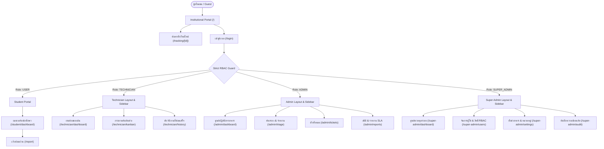

# รายงานสถาปัตยกรรมระบบ 4-Tier Distinct Role Dashboards & Strict RBAC

ระบบ **CampusOps** ได้รับการ Refactor โครงสร้างแดชบอร์ดใหม่ทั้งหมด โดย **แยกหน้าแดชบอร์ด, แถบเมนูนำทาง (Sidebar/Layout), และเส้นทาง URL ของแต่ละบทบาทออกจากกัน 100%** โดยไม่มีการใช้หน้าร่วมกัน

---

## 1. ผังโครงสร้างเส้นทางและสิทธิ์การเข้าถึง (Strict Role-Based Architecture)

---

## 2. รายละเอียดแดชบอร์ดและ Sidebar ของแต่ละบทบาท

### 1) Technician (ช่างเทคนิคภาคสนาม)
- **URL หลัก:** [`/technician/dashboard`](file:///c:/Campus%20Facility%20Maintenance%20and%20Issue%20Tracking%20System/app/technician/dashboard/page.tsx)
- **Sidebar เฉพาะ:** [TechnicianSidebar.tsx](file:///c:/Campus%20Facility%20Maintenance%20and%20Issue%20Tracking%20System/components/technician/TechnicianSidebar.tsx) แสดงสถานะ *"พร้อมปฏิบัติการเวรหน้างาน"* ไฟเขียวกระพริบ, รหัสประจำตัวช่าง, เมนูงานของฉัน, กระดานคันบัน, และประวัติงาน
- **ความสามารถเด่น:**
  - แสดงเฉพาะงานที่มอบหมายให้ช่างคนนี้ (Assigned to Me)
  - ปุ่ม **"เริ่มงานซ่อม"** เพื่ออัปเดตเป็น `IN_PROGRESS`
  - ปุ่ม **"แนบรูป & ปิดงาน"** เพื่อเปิด Modal บันทึกผลการซ่อมและอัปโหลดภาพหลักฐานหลังซ่อม (Proof of Work)
  - กระดานคันบันงานช่างเฉพาะตัว [`/technician/kanban`](file:///c:/Campus%20Facility%20Maintenance%20and%20Issue%20Tracking%20System/app/technician/kanban/page.tsx)

---

### 2) Admin (หัวหน้างานอาคารสถานที่ / แอดมินกลาง)
- **URL หลัก:** [`/admin/dashboard`](file:///c:/Campus%20Facility%20Maintenance%20and%20Issue%20Tracking%20System/app/admin/dashboard/page.tsx)
- **Sidebar เฉพาะ:** [AdminSidebar.tsx](file:///c:/Campus%20Facility%20Maintenance%20and%20Issue%20Tracking%20System/components/admin/AdminSidebar.tsx) เมนูภาพรวมงานซ่อม, คัดกรองและจ่ายงาน, ตั๋วแจ้งซ่อมทั้งหมด, และรายงานสถิติ SLA
- **ความสามารถเด่น:**
  - สถิติปัญหาจำแนกตามอาคาร (Incidents by Building Bar Chart) 5 อันดับแรก
  - ตารางคิวงานที่ยังไม่มอบหมาย (Unassigned Triage Queue)
  - ปุ่ม **"มอบหมายช่าง"** เปิด Modal จ่ายงานให้ช่างแต่ละคน พร้อมระบุเป้าหมาย SLA ถึงหน้างาน
  - บัญชีเวรทีมช่างพร้อมปฏิบัติการ (Technician Roster)

---

### 3) Super Admin (ผู้ดูแลระบบสูงสุด / IT & Security Hub)
- **URL หลัก:** [`/super-admin/dashboard`](file:///c:/Campus%20Facility%20Maintenance%20and%20Issue%20Tracking%20System/app/super-admin/dashboard/page.tsx)
- **Sidebar เฉพาะ:** [SuperAdminSidebar.tsx](file:///c:/Campus%20Facility%20Maintenance%20and%20Issue%20Tracking%20System/components/super-admin/SuperAdminSidebar.tsx) สัญลักษณ์มงกุฎม่วง Badge `ROOT` เมนูศูนย์ควบคุมระบบ, จัดการผู้ใช้และสิทธิ์, ตั้งค่าอาคาร, และบันทึกความปลอดภัย
- **ความสามารถเด่น:**
  - สรุปสถานะ Infrastructure Health (PostgreSQL 17, Next.js 14, JWT Auth, Prisma ORM)
  - สถิติกระจายสิทธิ์ผู้ใช้ครบทั้ง 4 Roles
  - หน้าย่อยจัดการสิทธิ์ผู้ใช้งานและปรับ Role แบบเรียลไทม์ [`/super-admin/users`](file:///c:/Campus%20Facility%20Maintenance%20and%20Issue%20Tracking%20System/app/super-admin/users/page.tsx)
  - หน้าจัดการ Master Data อาคารและหมวดหมู่ [`/super-admin/settings`](file:///c:/Campus%20Facility%20Maintenance%20and%20Issue%20Tracking%20System/app/super-admin/settings/page.tsx)

---

### 4) Student / User (นักศึกษาและบุคลากรทั่วไป)
- **URL หลัก:** [`/student/dashboard`](file:///c:/Campus%20Facility%20Maintenance%20and%20Issue%20Tracking%20System/app/student/dashboard/page.tsx)
- **ความสามารถเด่น:**
  - บัตรโปรไฟล์นักศึกษา พร้อมปุ่มส่งคำร้องแจ้งซ่อมใหม่
  - สรุปสถานะงานของฉัน (งานทั้งหมด, รอดำเนินการ, กำลังซ่อม, ปิดงาน)
  - ตารางประวัติการแจ้งซ่อมเฉพาะของตนเอง พร้อมปุ่มติดตามงานเปิด Timeline ไดนามิก

---

## 3. ตารางเปรียบเทียบสิทธิ์และการป้องกันระดับ Edge Middleware

| บทบาท (Role) | URL แดชบอร์ดหลัก | Layout & Sidebar | สิทธิ์เข้าถึงเส้นทางอื่น |
| :--- | :--- | :--- | :--- |
| **USER** | `/student/dashboard` | MainNavbar Topbar | เข้าได้เฉพาะ `/student/*`, `/report`, `/tracking/*` (หากเข้า `/admin/*` หรือ `/super-admin/*` หรือ `/technician/*` จะถูกเด้งกลับ Dashboard ตนเองทันที) |
| **TECHNICIAN** | `/technician/dashboard` | `TechnicianSidebar` | เข้าได้เฉพาะ `/technician/*`, `/tracking/*` (ห้ามเข้า `/admin/*` และ `/super-admin/*`) |
| **ADMIN** | `/admin/dashboard` | `AdminSidebar` | เข้าได้เฉพาะ `/admin/*`, `/tracking/*` (ห้ามเข้า `/super-admin/*`) |
| **SUPER_ADMIN** | `/super-admin/dashboard` | `SuperAdminSidebar` | เข้าถึงได้ทุกระบบในฐานะผู้ดูแลสูงสุด |

---

## 4. บัญชีทดสอบสำหรับ Demo (รหัสผ่านเริ่มต้น: `123456`)
- 👑 **Super Admin:** `superadmin@campus.ac.th` -> เข้าสู่ `/super-admin/dashboard`
- 🏢 **Admin อาคาร:** `admin@campus.ac.th` -> เข้าสู่ `/admin/dashboard`
- 🔧 **Technician ช่าง:** `tech.alex@campus.ac.th` -> เข้าสู่ `/technician/dashboard`
- 🎓 **Student นักศึกษา:** `student.supawit@campus.ac.th` -> เข้าสู่ `/student/dashboard`
